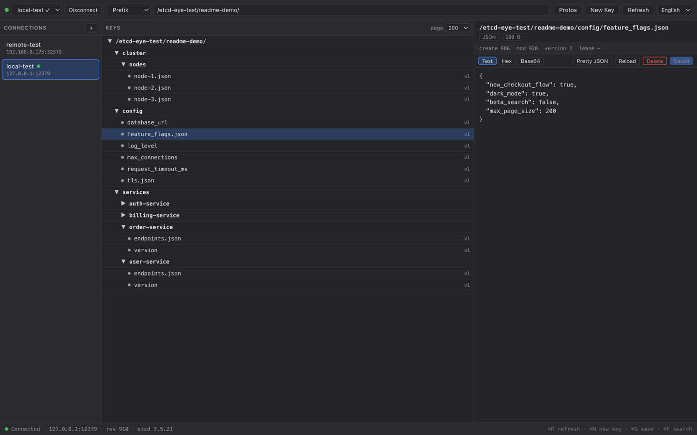

<div align="center">

# Etcura

**A lightweight, cross-platform etcd desktop client — macOS · Windows · Linux**

[简体中文](README.md) | English

Go · Wails v2 · Svelte · TypeScript · one codebase, native desktop apps on every platform

</div>

---

**Etcura** (a blend of **et**cd and **cura**te, as in carefully looking after your data) is a
stable, lightweight, fast-launching **cross-platform** GUI for etcd
(macOS / Windows / Linux) built for daily use: connection management, tree browsing,
viewing / creating / editing (CAS-protected) / deleting keys, and automatic Protobuf value
decoding. Go handles all etcd communication; the frontend only talks to Wails bindings. It is
built for large clusters — **smooth at up to million-key scale** — with cursor pagination and
server-side filtering everywhere and a memory footprint that does not grow with key count; it
never loads the whole database.

<div align="center">
  
  <p><sub>Three panes: connection profiles · key tree · value inspector — shown here in English; switch to 简体中文 from the toolbar</sub></p>
</div>

## Features

- **Cross-platform**: built on Wails v2 (Go + the native system WebView of each platform); the
  same codebase produces native desktop apps everywhere, distributed via
  [Releases](https://github.com/SH-Wang123/etcura/releases)
- **Connection management**: multiple profiles (name / multiple endpoints / username / TLS /
  timeouts); Test Connection performs a real `Status` RPC; passwords live in the macOS
  Keychain — the config file never stores plaintext secrets
- **Tree browsing**: single indented tree, lazily expanded directories, click a leaf key to
  inspect it; server-side cursor pagination (200 rows per level by default, hard-capped at
  1000 by the backend), in-tree `More…` incremental loading; virtual scrolling keeps the DOM
  constant; keys-only metadata only — **values are never loaded with the list and the
  database is never scanned in bulk**
- **Search**: prefix mode (etcd prefix range, executed server-side) + exact key lookup
- **Value viewer/editor**: UTF-8 / binary (hex and Base64 views); large-value size badge;
  JSON badge with on-demand formatting
- **Protobuf decoding**: import .proto files (cross-file imports supported, no protoc
  needed); binary values are matched against every imported message type (wire-structure
  prefilter + score ranking); read-only Proto view shows decoded JSON; candidates are
  switchable
- **Safe writes**: creating checks existence first (overwrite requires confirmation); saving
  uses `Txn + Compare(ModRevision)` CAS — on conflict you are asked to reload, never
  silently overwritten; deletes are single-key only and always confirmed (server + full key
  shown)
- **i18n**: Simplified Chinese / English UI, follows the system language, switchable anytime
  (error messages included)
- **Shortcuts**: ⌘R refresh · ⌘N new key · ⌘S save · ⌘F search
- **Dark mode**: follows the system appearance

## Tech stack

| Layer | Technology |
|---|---|
| Backend | Go 1.25+, Wails v2, go.etcd.io/etcd/client/v3, bufbuild/protocompile (proto parsing), standard-library concurrency |
| Frontend | Svelte 5, TypeScript strict, Vite, vanilla CSS, self-made virtual scrolling and i18n (zero UI framework, zero i18n library) |
| Desktop | Wails v2 (Go + each platform's system WebView), covering macOS / Windows / Linux; macOS arm64 / amd64 builds verified |

No Electron / Node backend / Tauri / SQLite / full-database caching / bulk loading.

## Project layout

```
etcura/
├── main.go                  # Wails entry (window, lifecycle)
├── app.go                   # Wails binding layer (thin + request-cancellation policy)
├── internal/
│   ├── etcd/                # client lifecycle, ListLevel pagination, CAS writes, error mapping
│   ├── protodec/            # proto import & value matching (protocompile + dynamicpb)
│   ├── model/               # shared wire models
│   └── config/              # connections.json + macOS Keychain
├── scripts/
│   ├── seed/main.go         # benchmark data generator (100k keys in one run)
│   ├── bench/main.go        # pagination walk + Go heap benchmark
│   ├── build.sh             # build + ad-hoc signing (handles codesign races)
│   └── dev.sh               # reliable wails dev (fixes hot-reload in iCloud-synced dirs)
├── frontend/
│   ├── src/lib/i18n.ts      # bilingual dictionaries & locale state
│   ├── src/components/      # Toolbar / Sidebar / KeyTree / Inspector / dialogs
│   ├── src/stores/          # connection state / tree signals / proto imports
│   └── wailsjs/             # Wails-generated bindings
├── docs/                    # docs assets (README screenshot)
└── build/bin/               # build output (etcura.app / zip, not committed)
```

## Getting started

### Download & install (Releases, recommended for most users)

Etcura follows a "one codebase, per-platform packages" model and is distributed via
[Releases](https://github.com/SH-Wang123/etcura/releases/latest). macOS packages are
available today — **Apple Silicon (arm64)** / **Intel (amd64)** / **Universal**; Windows and
Linux packages will follow in upcoming releases. Unzip and drag `etcura.app` into
/Applications — no installer needed.

> Builds are currently ad-hoc signed and not notarized, so Gatekeeper may warn on first
> launch. Either right-click the app → Open, or run `xattr -cr /Applications/etcura.app`
> in a terminal before opening.

## Local development & debugging

### Requirements

- Go ≥ 1.25, Node ≥ 20, Xcode Command Line Tools

### Install Wails

```bash
go install github.com/wailsapp/wails/v2/cmd/wails@latest
wails doctor   # verify dependencies
```

### Development

```bash
npm --prefix frontend install
./scripts/dev.sh        # reliable wails dev (recommended)
# or: wails dev
```

> If the project lives in an iCloud-synced folder (e.g. `~/Documents`), the `wails dev`
> signing step can race with the file provider and hot reload silently keeps running stale
> code — `scripts/dev.sh` handles this automatically. Moving the project out of the synced
> folder avoids the issue entirely.

### Start a local etcd for testing

```bash
etcd --name test --data-dir /tmp/etcd-test \
  --listen-client-urls http://127.0.0.1:12379 \
  --advertise-client-urls http://127.0.0.1:12379 \
  --listen-peer-urls http://127.0.0.1:12380 \
  --initial-advertise-peer-urls http://127.0.0.1:12380
```

In the app, add a connection with endpoint `127.0.0.1:12379` (one per line), Test Connection,
then Save & Connect.

### Generate benchmark data

```bash
go run ./scripts/seed -endpoints 127.0.0.1:12379 -count 100000
# flags: -prefix /benchmark/ -concurrency 16 -batch 120 -clean
```

### Pagination memory benchmark

```bash
go run ./scripts/bench -endpoints 127.0.0.1:12379 -pages 100 -page-size 200 -rounds 3
```

The benchmark drives the exact pagination code path used by the app. Reference result
(Apple Silicon, local etcd, 100k keys, 3 rounds × 100 pages × 200 rows): ~0.3s per round,
Go heap steady at ~1.1 MB — no growth with browsing volume.

## Build the macOS app

```bash
./scripts/build.sh              # arm64 (Apple Silicon, primary target)
./scripts/build.sh amd64        # Intel
./scripts/build.sh universal    # universal binary
```

Output: `build/bin/etcura.app` (ad-hoc signed, runs directly) plus a zip archive.

## Running tests

```bash
go test ./internal/...                                      # unit tests
ETCD_ENDPOINTS=127.0.0.1:12379 go test -tags integration ./internal/etcd/ -v   # integration (needs local etcd)
npm --prefix frontend run check                             # svelte-check (strict TS)
npm --prefix frontend run build                             # frontend build
```

## Configuration storage

- Connection profiles: `~/Library/Application Support/etcura/connections.json` (0600, no passwords)
- Passwords: macOS Keychain (service `etcura`)
- UI language: `localStorage` (defaults to the system language)

## Design notes (why it is fast and memory-friendly)

- List requests fetch **keys-only metadata**; values are fetched only when a key is clicked
- Each page requests `Limit = page size + 1` to infer "has next page" — no counting scans, ever
- Every tree level is scanned & deduplicated server-side by `ListLevel` (directory segments
  interleaved with direct leaves); the cursor guarantees no duplicates or gaps across pages,
  with a hard per-page scan budget
- One long-lived client per connection; switching closes the old client first
- Every RPC runs under `context.WithTimeout`; starting a new query cancels the previous
  in-flight one; the UI keeps generation counters against out-of-order responses
- Shutdown: cancel outstanding requests → close the client → exit; no goroutine or context leaks

## Roadmap (Phase 2 candidates)

Watch live refresh · Lease management · key history & diff · tabs · Import/Export ·
directory-first sorting option · signed & notarized builds · Windows / Linux builds
