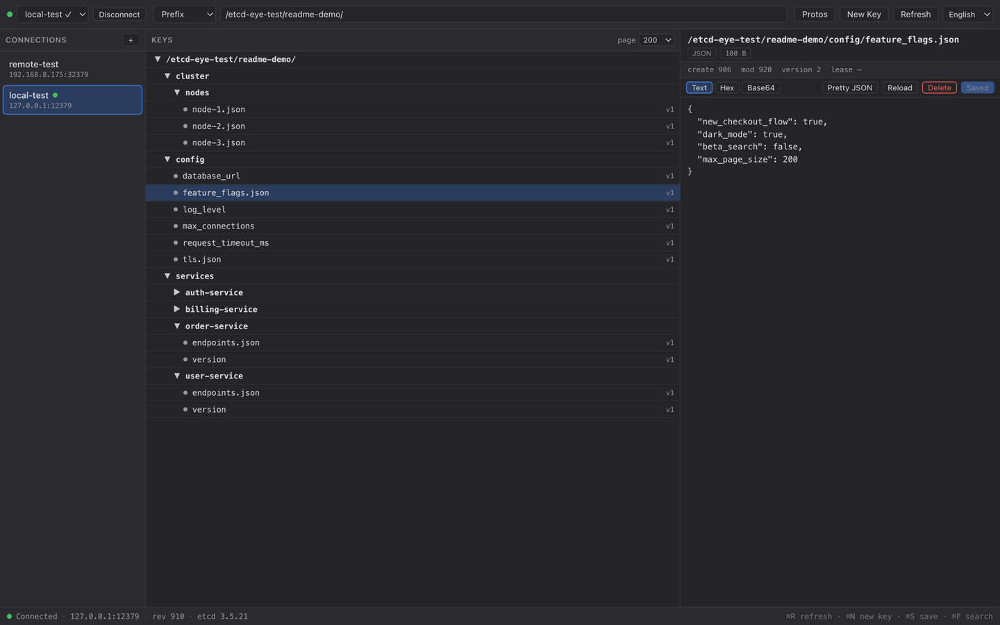

<div align="center">

# Etcd Eye

**轻量级跨平台 etcd 桌面管理工具 —— macOS · Windows · Linux**

简体中文 | [English](README.en.md)

Go · Wails v2 · Svelte · TypeScript · 一套代码，各平台原生桌面应用

</div>

---

Etcd Eye 是一个"稳定、轻量、启动快、可长期日常使用"的跨平台 etcd 图形客户端
（macOS / Windows / Linux）：连接管理、目录树浏览、查看/新建/编辑（CAS 防覆盖）/删除 key、
Protobuf 值自动解码。Go 承担全部 etcd 通信，前端只通过 Wails 绑定调用；专为大规模集群设计，
**最高可流畅支撑百万级 key** —— 全程游标分页 + 服务端过滤，内存占用不随 key 总量增长，
绝不一次性加载数据库。

<div align="center">
  
  <p><sub>三栏布局：连接管理 · 目录树浏览 · 值查看/编辑 —— 截图为英文界面，可在工具栏一键切换为简体中文</sub></p>
</div>

## 功能特性

- **跨平台**：基于 Wails v2（Go + 各平台系统 WebView），同一代码库构建各平台原生桌面应用，
  安装包统一通过 [Releases](https://github.com/SH-Wang123/etcd-eye/releases) 分发
- **连接管理**：多配置（名称 / 多 Endpoints / 用户名 / TLS / 超时），测试连接走真实
  `Status` RPC；密码存 macOS 钥匙串，配置文件永不落盘明文
- **目录树浏览**：单列缩进目录树，目录懒展开、叶子 key 点击即查看；服务端游标分页
  （每层 200 行起、上限 1000 由后端钳制），单层超一页时树内 `More…` 增量加载；
  虚拟滚动保持 DOM 恒定，只拉 keys-only 元数据，**绝不加载 Value、绝不全库扫描**
- **查询**：前缀模式（etcd prefix range，服务端执行）+ 精确 key 点查
- **值查看/编辑**：UTF-8 / 二进制（十六进制、Base64 视图）；大值显示尺寸徽标；
  JSON 徽标 + 手动格式化
- **Protobuf 解码**：导入 .proto 文件（支持跨文件 import，无需 protoc），二进制值
  自动匹配所有已导入消息类型（wire 结构快速过滤 + 评分排序），Proto 视图只读展示
  解码 JSON，候选可切换
- **安全写入**：新建前检查存在性（已存在需确认覆盖）；保存走 `Txn + Compare(ModRevision)`
  CAS，冲突时提示重载，绝不静默覆盖；删除仅限单 key 且强制确认（显示服务器与完整 key）
- **国际化**：简体中文 / English 界面，跟随系统语言，可随时切换（含错误消息本地化）
- **快捷键**：⌘R 刷新 · ⌘N 新建 · ⌘S 保存 · ⌘F 搜索
- **深色模式**：跟随系统外观

## 技术栈

| 层 | 技术 |
|---|---|
| 后端 | Go 1.25+、Wails v2、go.etcd.io/etcd/client/v3、bufbuild/protocompile（proto 解析）、标准库并发 |
| 前端 | Svelte 5、TypeScript strict、Vite、原生 CSS、自研虚拟滚动与 i18n（零 UI 框架、零 i18n 库） |
| 桌面 | Wails v2（Go + 各平台系统 WebView），覆盖 macOS / Windows / Linux；已验证 macOS arm64 / amd64 构建 |

不使用 Electron / Node 后端 / Tauri / SQLite / 全库缓存 / 一次性加载。

## 目录结构

```
etcd-eye/
├── main.go                  # Wails 入口（窗口、生命周期）
├── app.go                   # Wails 绑定层（薄封装 + 请求取消策略）
├── internal/
│   ├── etcd/                # client 生命周期、ListLevel 分页、CAS 写入、错误映射
│   ├── protodec/            # proto 导入与值匹配（protocompile + dynamicpb）
│   ├── model/               # 前后端共享数据模型
│   └── config/              # connections.json + macOS 钥匙串
├── scripts/
│   ├── seed/main.go         # benchmark 数据生成（10 万 key 一键写入）
│   ├── bench/main.go        # 分页遍历 + Go 侧堆内存基准
│   ├── build.sh             # 构建 + ad-hoc 签名（自动处理 codesign 竞速问题）
│   └── dev.sh               # 可靠的 wails dev 启动（iCloud 目录热重载修复）
├── frontend/
│   ├── src/lib/i18n.ts      # 双语词典与语言状态
│   ├── src/components/      # Toolbar / Sidebar / KeyTree / Inspector / 各对话框
│   ├── src/stores/          # 连接状态 / 树信号 / proto 导入
│   └── wailsjs/             # Wails 自动生成的绑定
├── docs/                    # 文档资源（README 截图）
└── build/bin/               # 构建产物（etcd-eye.app / zip，不入库）
```

## 快速开始

### 下载安装（Releases，推荐大多数用户）

Etcd Eye 以"一套代码、多平台安装包"的方式通过
[Releases](https://github.com/SH-Wang123/etcd-eye/releases/latest) 分发。当前已提供 macOS 包：
**Apple Silicon (arm64)** / **Intel (amd64)** / **Universal**，Windows 与 Linux 安装包将在
后续版本加入。解压得到 `etcd-eye.app`，拖入「应用程序」即可使用。

> 构建目前为 ad-hoc 签名、尚未公证，首次打开如遇 Gatekeeper 提示，任选其一：
> 右键点击 App → 「打开」；或在终端执行 `xattr -cr /Applications/etcd-eye.app` 后再打开。

## 本地开发与调试

### 环境要求

- Go ≥ 1.25、Node ≥ 20、Xcode Command Line Tools

### 安装 Wails

```bash
go install github.com/wailsapp/wails/v2/cmd/wails@latest
wails doctor   # 检查依赖
```

### 开发运行

```bash
npm --prefix frontend install
./scripts/dev.sh        # 可靠的 wails dev（推荐）
# 或：wails dev
```

> 项目放在 iCloud 同步目录（如 `~/Documents`）时，`wails dev` 的签名步骤可能与
> file provider 竞速失败，导致热重载静默跑旧代码——`scripts/dev.sh` 已自动处理。
> 彻底规避可把项目移到非同步目录。

### 启动本地 etcd 测试

```bash
etcd --name test --data-dir /tmp/etcd-test \
  --listen-client-urls http://127.0.0.1:12379 \
  --advertise-client-urls http://127.0.0.1:12379 \
  --listen-peer-urls http://127.0.0.1:12380 \
  --initial-advertise-peer-urls http://127.0.0.1:12380
```

应用内添加连接：Endpoints 填 `127.0.0.1:12379`（每行一个），Test Connection 后保存并连接。

### 生成 benchmark 数据

```bash
go run ./scripts/seed -endpoints 127.0.0.1:12379 -count 100000
# 参数：-prefix /benchmark/ -concurrency 16 -batch 120 -clean
```

### 分页内存基准

```bash
go run ./scripts/bench -endpoints 127.0.0.1:12379 -pages 100 -page-size 200 -rounds 3
```

基准走与应用完全相同的分页代码路径。参考结果（Apple Silicon，本地 etcd，
10 万 key，连续 3 轮 × 100 页 × 200 行）：每轮 ~0.3s，Go 堆稳定在 ~1.1 MB，
不随浏览量增长。

## 构建 macOS App

```bash
./scripts/build.sh              # arm64（Apple Silicon，第一优先）
./scripts/build.sh amd64        # Intel
./scripts/build.sh universal    # 通用二进制
```

产物：`build/bin/etcd-eye.app`（ad-hoc 签名，可直接运行）与同名 zip。

## 运行测试

```bash
go test ./internal/...                                      # 单元测试
ETCD_ENDPOINTS=127.0.0.1:12379 go test -tags integration ./internal/etcd/ -v   # 集成测试（需本地 etcd）
npm --prefix frontend run check                             # svelte-check（strict TS）
npm --prefix frontend run build                             # 前端构建
```

## 配置存储

- 连接配置：`~/Library/Application Support/etcd-eye/connections.json`（0600，不含密码）
- 密码：macOS 钥匙串（service `etcd-eye`）
- 界面语言：`localStorage`（默认跟随系统语言）

## 设计要点（为什么它快且省内存）

- 浏览列表只请求 **keys-only 元数据**，Value 仅在点击时拉取
- 每页请求 `Limit = 页大小 + 1` 推断"是否有下一页"，不为总数做任何扫描
- 树的每一层由 `ListLevel` 在服务端扫描去重（目录段 + 直连叶子混排），
  游标保证跨页不重不漏，每页扫描有硬预算
- 每个连接一个长期存活的 client；切换时先关旧再建新
- 所有 RPC 带 `context.WithTimeout`；新查询自动取消上一个 in-flight 请求；
  UI 侧另有代际号防乱序
- 退出时取消在途请求 → 关闭 client → 退出，无 goroutine/context 泄漏

## 路线图（Phase 2 候选）

Watch 实时刷新 · Lease 管理 · key 历史与 diff · 多标签页 · Import/Export ·
目录置顶排序选项 · 正式签名与公证 · Windows / Linux 版本
